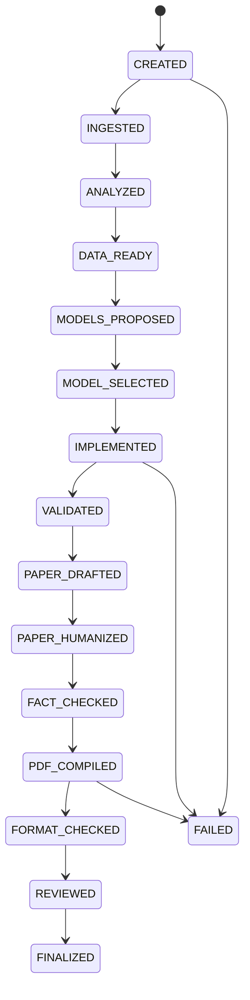
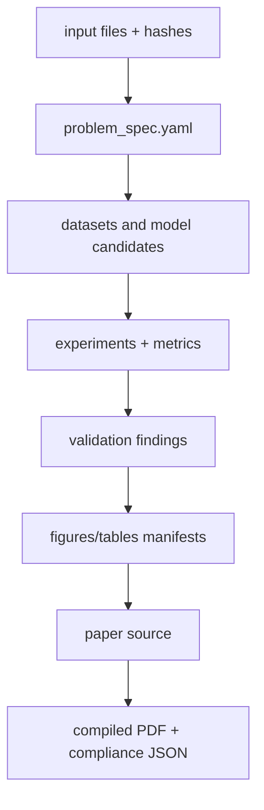
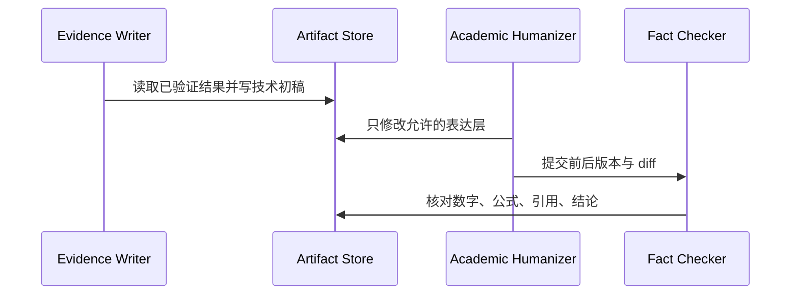
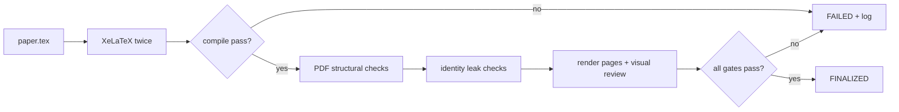

# 系统架构

## 总体架构

```mermaid
flowchart LR
  U["用户与赛题附件"] --> O["Orchestrator"]
  O --> S["阶段 Skills"]
  S --> W["Workspace artifacts"]
  W --> V["验证与一致性门禁"]
  V --> E["Evidence Writer"]
  E --> H["Academic Humanizer"]
  H --> F["事实一致性检查"]
  F --> L["XeLaTeX renderer"]
  L --> C["CUMCM compliance"]
  C --> R["隔离 Reviewer"]
  R --> P["Final package"]
```

Orchestrator 只读取状态、选择下一阶段、检查输入输出和执行有限重试。专业 Skill 对明确文件接口负责。Reviewer 不接收 writer 的对话上下文，也不修改建模结果。

## 状态机

状态只在阶段验收成功后推进。失败保存 `failed_stage`、错误摘要和已存在产物；恢复从失败阶段重新执行，不回滚已验证的前序产物。

## 数据流与接口

YAML/JSON 通过 Pydantic 校验。大文件只记录相对路径、媒体类型、大小和 SHA-256。每个产物在 state 中登记，不把自由文本当作唯一事实源。

## Workspace 生命周期

`init` 创建结构与初始清单；ingest 复制或登记输入；阶段命令先校验依赖产物再运行；每次运行写独立 manifest；final 目录只接收验收通过的副本。删除与归档不属于第一阶段。

第二阶段执行器以无 shell 的子进程运行 `code/solve.py`，把输入 SHA-256、Python/依赖版本、命令、stdout、stderr、结果和逐次 `runs/*.yaml` 落盘。结果必须通过 Pydantic schema，且验证器独立重算关键指标后才能生成报告。`resume` 只读取 `state.yaml` 决定下一步；失败产物不被删除，便于审计和重跑。

## 写作与审校

## PDF 验收

## 人工检查点与 subagents

assisted 模式在 ANALYZED、MODEL_SELECTED、VALIDATED 后和 FINALIZED 前要求确认，并把选择写入 `decisions.md`。后续 subagents 只用于可并行且文件写入互斥的研究、数据审计或独立候选模型；Orchestrator 汇总，禁止多个 agent 同时修改核心状态或同一代码文件。
